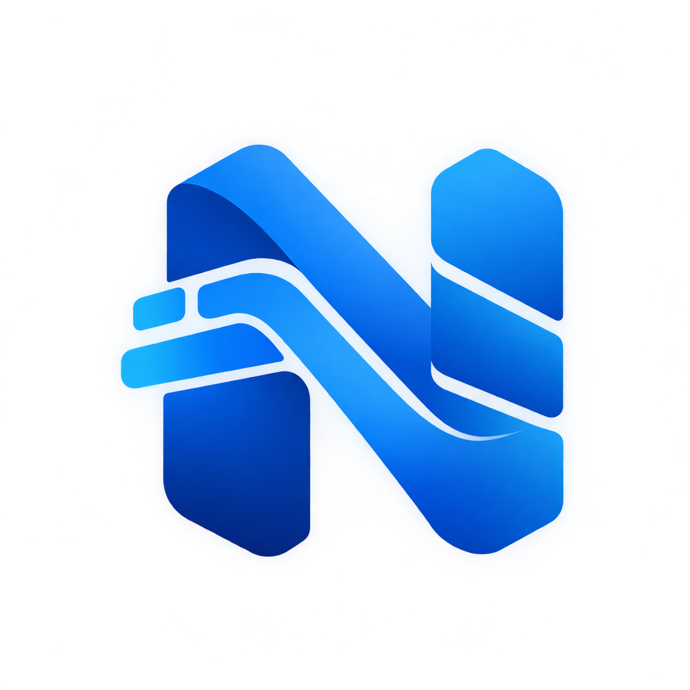
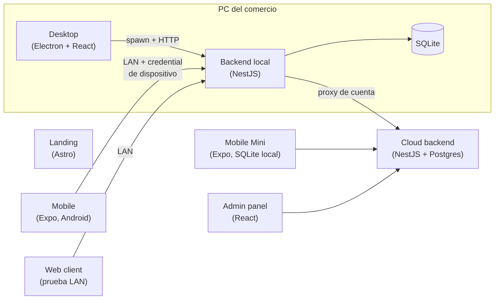

<p align="center">
  
</p>

<h1 align="center">StockNegozia</h1>

<p align="center">
  Sistema de gestión de stock, ventas y finanzas para pequeños comercios —
  escritorio, celular y nube, en un único monorepo TypeScript.
</p>

<p align="center">
  <a href="https://github.com/rodrireddev/StockNegozia/actions/workflows/ci.yml"></a>
  <a href="LICENSE"></a>
  = 20" />
  
</p>

---

## Índice

1. [Qué es](#qué-es)
2. [Funcionalidades](#funcionalidades)
3. [Arquitectura](#arquitectura)
4. [Tecnologías](#tecnologías)
5. [Estructura del repositorio](#estructura-del-repositorio)
6. [Requisitos](#requisitos)
7. [Instalación y ejecución](#instalación-y-ejecución)
8. [Configuración (variables de entorno)](#configuración-variables-de-entorno)
9. [Tests y calidad](#tests-y-calidad)
10. [Build, instaladores y actualizaciones](#build-instaladores-y-actualizaciones)
11. [Seguridad](#seguridad)
12. [Datos, backups y migraciones](#datos-backups-y-migraciones)
13. [Documentación técnica](#documentación-técnica)
14. [Limitaciones y trabajo futuro](#limitaciones-y-trabajo-futuro)
15. [Licencia y autoría](#licencia-y-autoría)

## Qué es

StockNegozia es una plataforma para que un comercio chico (almacén, kiosco, ferretería,
local de ropa) lleve **productos, stock, ventas, compras, clientes y finanzas** sin depender de
internet. El núcleo corre **localmente**: una app de escritorio levanta su propio backend con una
base SQLite en la PC del negocio, y los celulares/tablets del local se conectan a ella por la red
WiFi (LAN) tras emparejarse con un QR.

Alrededor de ese núcleo hay piezas opcionales: una versión **standalone para celular** (sin PC),
un **backend en la nube** para cuentas, créditos y gamificación, un **panel de administración** y
una **landing** pública.

## Funcionalidades

| Área                | Qué incluye                                                                                                                                                                                                                                                               |
| ------------------- | ------------------------------------------------------------------------------------------------------------------------------------------------------------------------------------------------------------------------------------------------------------------------- |
| **Productos**       | Alta/edición, categorías, SKU y código de barras, búsqueda y filtros, stock mínimo, activar/desactivar, escaneo con lector o cámara.                                                                                                                                      |
| **Ventas**          | Carrito con búsqueda/escaneo, pago mixto (efectivo, débito, crédito en cuotas, transferencia, QR, **cuenta corriente**), recargos y comisiones configurables, vuelto, recibo PDF no fiscal, cancelación con devolución de stock, **cliente opcional**.                    |
| **Compras**         | Registro por proveedor con costo editable por línea; actualiza stock y costo histórico.                                                                                                                                                                                   |
| **Inventario**      | Movimientos de stock auditables e inmutables (venta, compra, ajuste, cancelación) con precio histórico.                                                                                                                                                                   |
| **Clientes**        | Alta/edición (teléfono, email, DNI/CUIT, notas), historial (compras, total, última compra) y **cuenta corriente (fiado)**: ventas a cuenta, saldo por cliente, registro de pagos con su medio y movimientos. En Desktop, Mobile (elegir cliente al vender) y Mobile Mini. |
| **Finanzas**        | Ganancia por venta (precio − costo histórico), compras del período, caja y ajustes de caja, cobros pendientes de acreditar por medio de pago, **fiado a cobrar**, gráficos y ranking de productos.                                                                        |
| **Exportar**        | CSV listo para Excel (es-AR) de productos, ventas, compras y clientes — en Desktop se guarda con el diálogo nativo; en el celular se comparte (Drive, WhatsApp, mail, Archivos).                                                                                          |
| **Dispositivos**    | Emparejar celulares/tablets por QR + código, revocar, **roles Encargado / Cajero**.                                                                                                                                                                                       |
| **Backups**         | Backup y restore manual con validación, **backup automático diario** (últimos 7) y respaldo previo a cada actualización.                                                                                                                                                  |
| **Actualizaciones** | La app de escritorio se actualiza sola desde GitHub Releases.                                                                                                                                                                                                             |
| **Nube (opcional)** | Cuentas de comercio, créditos por uso/anuncios, rachas y logros, referidos, votación de funcionalidades.                                                                                                                                                                  |

## Arquitectura



- **El frontend nunca toca la base directamente**: todo pasa por la API HTTP del backend.
- **Electron no tiene lógica de negocio**: administra el ciclo de vida del backend (lo arranca,
  espera `/health`, lo detiene), guarda la credential cifrada (`safeStorage`) y muestra la ventana.
- **Contratos compartidos**: los DTOs (`packages/api-contracts`) y las validaciones zod
  (`packages/validation`) son los mismos en backend y clientes, así una regla se define una vez.
- **Transacciones**: venta, compra y ajuste de stock son atómicos (todo o nada) y cada cambio de
  stock deja un movimiento auditable.

## Tecnologías

| Capa                     | Stack                                                                                                                          |
| ------------------------ | ------------------------------------------------------------------------------------------------------------------------------ |
| Monorepo                 | pnpm workspaces + Turborepo, TypeScript estricto, ESLint, Prettier                                                             |
| Backend local            | NestJS 11, Drizzle ORM, SQLite (`better-sqlite3`), zod, logs JSONL estructurados                                               |
| Desktop                  | Electron 33, electron-vite, React 19, TanStack Query, Zustand, Tailwind + shadcn/ui, electron-builder (NSIS), electron-updater |
| Mobile / Mobile Mini     | React Native 0.86 + Expo 57, expo-router, expo-secure-store, expo-sqlite + Drizzle (Mini), EAS Build                           |
| Cloud backend            | NestJS 11, Drizzle ORM, PostgreSQL, JWT, Cloudflare Turnstile, verificación SSV de AdMob                                       |
| Admin panel / Web client | React 19 + Vite                                                                                                                |
| Landing                  | Astro 5 + Tailwind                                                                                                             |
| Tests                    | Vitest (+ supertest, Testing Library), Jest (React Native)                                                                     |
| CI / Deploy              | GitHub Actions, Render (cloud backend, admin panel, landing)                                                                   |

## Estructura del repositorio

```
StockNegozia/
├── apps/
│   ├── backend/        API local NestJS + SQLite (núcleo del negocio)
│   ├── desktop/        App de escritorio Electron (lanza el backend)
│   ├── mobile/         Cliente Android que se empareja con el backend por LAN
│   ├── mobile-mini/    App Android standalone, sin backend (SQLite en el teléfono)
│   ├── cloud-backend/  API en la nube: cuentas, créditos, gamificación (Postgres)
│   ├── admin-panel/    Panel web de administración del cloud backend
│   ├── web-client/     Cliente web mínimo para probar conectividad LAN
│   └── landing/        Sitio público estático
├── packages/
│   ├── api-contracts/  DTOs/tipos compartidos de la API
│   ├── validation/     Schemas zod compartidos (inputs y variables de entorno)
│   ├── shared/         Lógica pura compartida (carrito, dinero, pagos, CSV…)
│   └── config/         Configuración compartida de TS / ESLint / Prettier
├── docs/               Documentación técnica por área (ver más abajo)
├── assets/branding/    Logo e íconos fuente + generados
├── .github/workflows/  CI
└── render.yaml         Infraestructura de los servicios en la nube
```

Cada módulo de dominio del backend sigue la misma forma: `controller` (HTTP + validación) →
`service` (reglas de negocio, transacciones) → `repository` (queries Drizzle), con tests al lado.

## Requisitos

- **Node.js ≥ 20** (CI usa Node 24).
- **pnpm** — la versión exacta está en `packageManager` de `package.json` (`corepack enable` la activa).
- **Windows**: Visual Studio Build Tools (workload _Desktop development with C++_) + Python, para
  compilar `better-sqlite3`.
- **Mobile** (opcional): un teléfono Android con Expo Go o un dev client; los APK/AAB se generan
  con EAS (cuenta de Expo). Android Studio solo hace falta para compilar un dev client local.
- **Cloud backend** (opcional): una base PostgreSQL (local, Docker o Neon).

## Instalación y ejecución

```bash
git clone https://github.com/rodrireddev/StockNegozia.git
cd StockNegozia
pnpm install
pnpm dev
```

`pnpm dev` compila los paquetes compartidos y abre la app de escritorio, que arranca el backend
local en `http://localhost:38123`. **No hace falta ningún `.env`**: en desarrollo la API queda
abierta (`API_ACCESS_MODE=development`) y los datos se guardan en el directorio de usuario.

### Recorrido rápido para probarla

1. **Productos** → _+ Nuevo producto_ → nombre, SKU, precios y stock inicial.
2. **Clientes** → _+ Nuevo cliente_ (opcional).
3. **Ventas** → buscá o escaneá el producto, elegí el cliente arriba a la derecha, cobrá y confirmá.
4. **Ganancias** → mirá el resultado del día; _Exportar CSV_ en el detalle de ventas.
5. **Dispositivos** → _Emparejar dispositivo_ para sumar un celular (ver abajo) y asignarle rol.

### Otras apps

| App                   | Comando                                                                                                 | Notas                                                                                                          |
| --------------------- | ------------------------------------------------------------------------------------------------------- | -------------------------------------------------------------------------------------------------------------- |
| Solo el backend local | `pnpm --filter @stocknegozia/backend start:dev`                                                         | API en `:38123`, `GET /health`                                                                                 |
| Mobile (LAN)          | `pnpm --filter @stocknegozia/mobile start`                                                              | Copiar `apps/mobile/.env.example` a `.env` con la IP LAN de la PC — ver [LAN_TESTING](docs/lan/LAN_TESTING.md) |
| Mobile Mini           | `pnpm --filter @stocknegozia/mobile-mini start`                                                         | No necesita backend                                                                                            |
| Cloud backend         | `pnpm --filter @stocknegozia/cloud-backend db:migrate && pnpm --filter @stocknegozia/cloud-backend dev` | Requiere `DATABASE_URL` (Postgres), puerto `:38200`                                                            |
| Admin panel           | `pnpm --filter @stocknegozia/admin-panel dev`                                                           | `:5560`, consume el cloud backend                                                                              |
| Web client            | `pnpm --filter @stocknegozia/web-client dev`                                                            | `:5544`                                                                                                        |
| Landing               | `pnpm --filter @stocknegozia/landing dev`                                                               | `:4321`                                                                                                        |

## Configuración (variables de entorno)

Cada app trae su `.env.example` con todas las variables comentadas. Las más importantes del
backend local (`apps/backend/.env.example`):

| Variable                     | Default                                          | Para qué                                                                                                           |
| ---------------------------- | ------------------------------------------------ | ------------------------------------------------------------------------------------------------------------------ |
| `API_ACCESS_MODE`            | `development`                                    | `production` exige credential de dispositivo en cada request. **Usar `production` en cualquier instalación real.** |
| `STOCKNEGOZIA_PORT`          | `38123`                                          | Puerto de la API local.                                                                                            |
| `STOCKNEGOZIA_DATA_DIR`      | `./data` (Electron usa el directorio de usuario) | Dónde viven base, backups, logs.                                                                                   |
| `PAIRING_HOST`               | autodetectado                                    | IPv4 u hostname que va en el QR de emparejamiento (sin `http://` ni puerto).                                       |
| `PAIRING_EXPIRATION_MINUTES` | `5`                                              | Vigencia del QR.                                                                                                   |
| `LOG_LEVEL` / `LOG_DIR`      | `info` / `<dataDir>/logs`                        | Logging estructurado.                                                                                              |
| `CLOUD_BACKEND_URL`          | `http://localhost:38200`                         | URL del cloud backend (cuentas/créditos).                                                                          |

El backend valida todas las variables al arrancar (zod) y no levanta si alguna es inválida.
Los secretos del cloud backend (`DATABASE_URL`, secretos JWT, Turnstile) nunca se commitean: en
Render se cargan como `sync: false` (ver [`render.yaml`](render.yaml)).

## Tests y calidad

```bash
pnpm test        # todas las suites (Vitest + Jest)
pnpm typecheck   # tsc --noEmit en todo el monorepo
pnpm lint        # ESLint
```

- **Backend local**: unitarios y e2e (supertest) contra SQLite en memoria con las migraciones
  reales — incluye atomicidad de ventas/compras, pairing, revocación, roles, backups y cuenta
  corriente (saldo, pagos, cancelaciones e impacto en Finanzas).
- **Cloud backend**: créditos e idempotencia, compras de suscripciones, verificación de firmas de
  AdMob (SSV), hashing de contraseñas.
- **Desktop / Mobile / Web**: componentes y pantallas con Testing Library.
- **CI** ([`.github/workflows/ci.yml`](.github/workflows/ci.yml)): corre `format:check`,
  `typecheck`, `lint` y `test` en cada push a `main` y en cada pull request.
- **Formato**: `pnpm format` (Prettier) antes de commitear; el CI rechaza código sin formatear.

## Build, instaladores y actualizaciones

| Qué                                     | Comando                                                                       |
| --------------------------------------- | ----------------------------------------------------------------------------- |
| Instalador Windows local (`.exe`, NSIS) | `pnpm --filter @stocknegozia/desktop dist:win`                                |
| Publicar versión con auto-actualización | `GH_TOKEN=<token> pnpm --filter @stocknegozia/desktop release:win`            |
| APK/AAB Android                         | `pnpm --filter @stocknegozia/mobile build:preview` / `build:production` (EAS) |

**Cómo publicar una actualización del Desktop:** subir `version` en
`apps/desktop/package.json`, correr `release:win` con un token de GitHub con permiso de
_contents: write_. Eso crea un Release **borrador** con el instalador, `latest.yml` y el
`.blockmap`. Al publicarlo, las instalaciones existentes lo detectan al abrir, lo bajan en segundo
plano y ofrecen reiniciar. Los datos del usuario viven fuera de la carpeta de instalación y la base
se respalda antes de migrar, así que actualizar nunca borra información.

## Seguridad

- **Autenticación por dispositivo**: cada dispositivo tiene una credential propia (solo se guarda
  su hash). El primer Desktop la obtiene con un token de bootstrap de un solo uso; los demás se
  emparejan con QR + código de verificación de vida corta.
- **Roles**: el dispositivo **administrador** (el Desktop original) gestiona dispositivos y
  backups. Cada otro dispositivo es **Encargado** (acceso completo) o **Cajero**: vende, consulta
  productos/stock y carga clientes, pero no ve finanzas, no registra compras ni ajustes de caja,
  no edita productos/precios/proveedores/configuración ni cancela ventas. El backend lo hace
  cumplir (`403`); las apps además ocultan esas secciones.
- **Revocación** permanente de dispositivos, sin reactivación.
- **Credenciales**: cifradas con `safeStorage` en Electron y en el Keystore de Android
  (`expo-secure-store`) en mobile; nunca en `localStorage`.
- **Nube**: contraseñas con scrypt, JWT separados para cuentas y admins, captcha Turnstile en el
  registro, recompensas de anuncios verificadas con la firma de Google (no se confía en el cliente).
- **CSV**: las celdas que empiezan con `=`, `+`, `-` o `@` se neutralizan (evita inyección de
  fórmulas en Excel).

Detalle en [`docs/security/`](docs/security/).

## Datos, backups y migraciones

- La base SQLite vive en el directorio de usuario del sistema (`%APPDATA%/@stocknegozia/desktop`
  en Windows), separada de la instalación — desinstalar no borra datos.
- **Backup automático diario** en `<datos>/backups/auto/` (se conservan los últimos 7; protege de
  errores y corrupción, no de perder el disco).
- **Backup manual** a cualquier ubicación (pendrive, nube) y **restore** con validación de
  integridad y de versión de schema, copia de seguridad previa y rollback si algo falla.
- **Antes de cada actualización** con migraciones pendientes se guarda una copia en
  `<datos>/backups/pre-update/`.
- Migraciones con Drizzle: tras cambiar `apps/backend/src/database/schema/`, correr
  `pnpm --filter @stocknegozia/backend db:generate`. Se aplican solas al iniciar.

## Documentación técnica

| Tema                                  | Documento                                                                                                                |
| ------------------------------------- | ------------------------------------------------------------------------------------------------------------------------ |
| Acceso a la API y credentials         | [docs/security/API_ACCESS.md](docs/security/API_ACCESS.md)                                                               |
| Emparejamiento por QR                 | [docs/security/PAIRING.md](docs/security/PAIRING.md)                                                                     |
| Gestión de dispositivos y roles       | [docs/security/DEVICE_MANAGEMENT.md](docs/security/DEVICE_MANAGEMENT.md)                                                 |
| Pendientes de seguridad               | [docs/security/NEXT_STEPS.md](docs/security/NEXT_STEPS.md)                                                               |
| Movimientos de stock                  | [docs/inventory/STOCK_MOVEMENTS.md](docs/inventory/STOCK_MOVEMENTS.md)                                                   |
| Compras y proveedores                 | [docs/inventory/PURCHASES.md](docs/inventory/PURCHASES.md)                                                               |
| Escáner de productos                  | [docs/inventory/PRODUCT_SCANNER.md](docs/inventory/PRODUCT_SCANNER.md)                                                   |
| Backup y restore                      | [docs/backup/BACKUP_RESTORE.md](docs/backup/BACKUP_RESTORE.md)                                                           |
| Logging                               | [docs/logging/LOGGING.md](docs/logging/LOGGING.md), [LOG_SCHEMA.md](docs/logging/LOG_SCHEMA.md)                          |
| Red local (LAN)                       | [docs/lan/LAN_TESTING.md](docs/lan/LAN_TESTING.md), [DEVICE_MANAGEMENT.md](docs/lan/DEVICE_MANAGEMENT.md)                |
| Clientes móviles                      | [docs/mobile/MOBILE_CLIENT.md](docs/mobile/MOBILE_CLIENT.md), [MOBILE_MINI_CLIENT.md](docs/mobile/MOBILE_MINI_CLIENT.md) |
| Monetización, créditos y gamificación | [docs/monetization/ADS_CREDITS_GAMIFICATION.md](docs/monetization/ADS_CREDITS_GAMIFICATION.md)                           |
| Desktop: splash y tema                | [docs/desktop/SPLASH.md](docs/desktop/SPLASH.md), [THEME.md](docs/desktop/THEME.md)                                      |
| Google Play: seguridad de datos       | [docs/legal/PLAY_CONSOLE_DATA_SAFETY.md](docs/legal/PLAY_CONSOLE_DATA_SAFETY.md)                                         |

## Limitaciones y trabajo futuro

- **Facturación electrónica (AFIP)**: no implementada; el recibo PDF es no fiscal.
- **Usuarios con login/PIN** dentro de un mismo dispositivo: hoy los permisos son por dispositivo.
- **Exportar a `.xlsx`/PDF**: hoy es CSV (Excel lo abre directo).
- **Clientes en Mobile (LAN)**: se eligen al vender, pero se cargan y cobran desde Desktop.
- **Backup automático fuera de la PC** (nube, sincronización): el automático queda en el mismo disco.
- **macOS / Linux / iOS**: solo se empaqueta para Windows y Android.
- **Firma de código** del instalador Windows (sin ella, SmartScreen muestra un aviso la primera vez).

## Licencia y autoría

Distribuido bajo la licencia **MIT** — ver [`LICENSE`](LICENSE).

Proyecto desarrollado por **Rodri** ([@rodrireddev](https://github.com/rodrireddev)) como proyecto
universitario.
